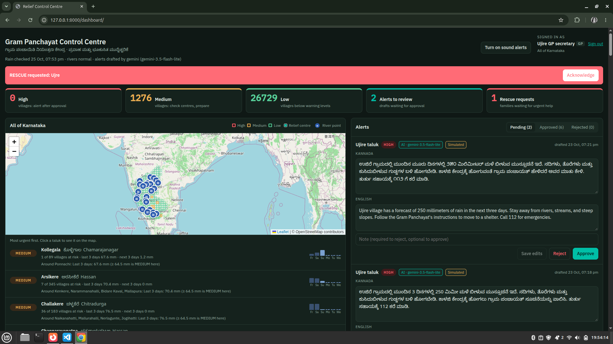
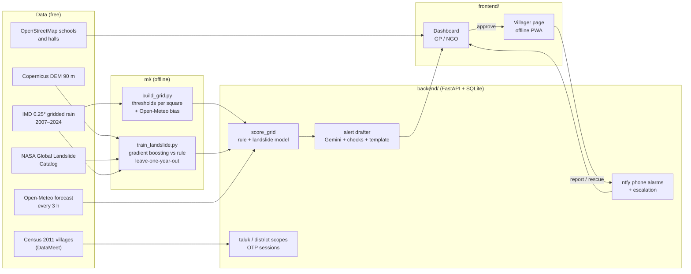
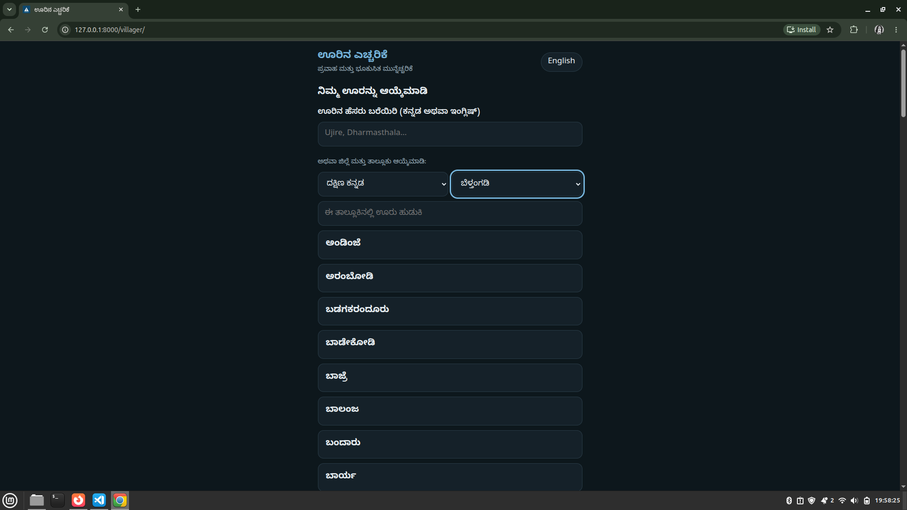
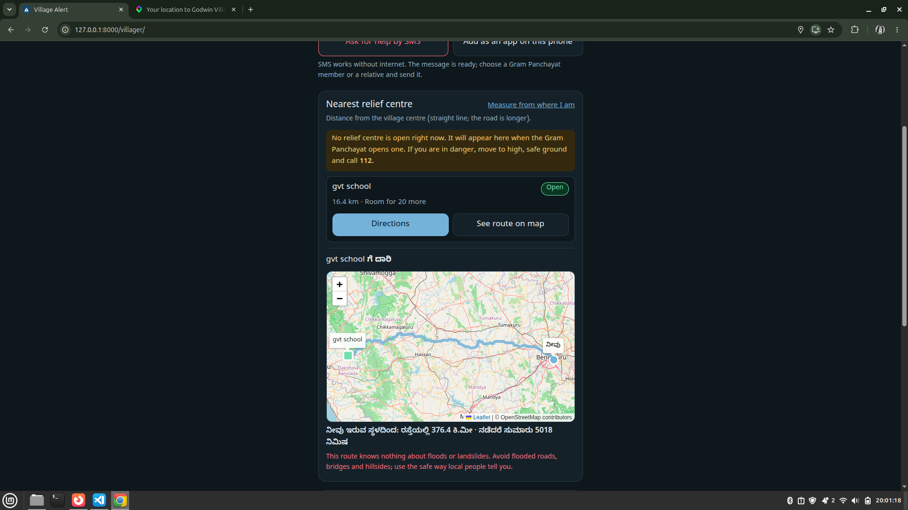
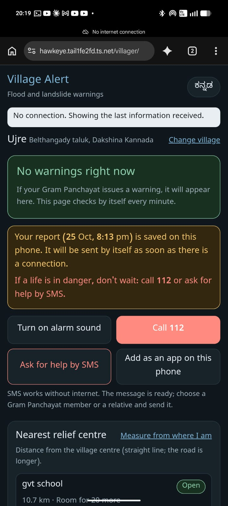

# Disaster AI: Flood & Landslide Early Warning for Karnataka

Village-level flood and landslide warnings for **all of Karnataka**: about 28,000 villages, 175 taluks and
31 districts. A calibrated rain rule and a machine-learned landslide model score every 27 km rain-grid
square several times a day. Gemini drafts a warning in Kannada and English, a Gram Panchayat official approves it,
and villagers see it on a phone page that keeps working without network. Families report where they are,
rescue requests ring officials' phones until someone acts, and relief centres are opened and counted from a
dashboard.

An AI-first rebuild of our PS-11 hackathon project (*Early Warning & Community Response System for Floods and
Landslides*, 3rd prize at Innovate-A-Thon 2026, SDM Institute of Technology, Ujire). Free data and free tools only.



---

## What each person gets

| Who | What they do |
|---|---|
| **Villager** (no sign-in to read) | Pick the village by name (spelling-tolerant: "Ujire" finds the census name "Ujre") → approved warnings in Kannada with siren and read-aloud → nearest open relief centre with a walking-route map → report the family's status (at a centre, with relatives, at home, missing) and ask for rescue. Works offline: reports wait on the phone and are sent when signal returns; an SMS button sends an SOS with GPS position without any data. Installs as an app. |
| **Gram Panchayat official** (phone + OTP, one taluk) | Risk per rain-grid square and per village in their taluk, AI-drafted alerts to edit and approve, each family's report with phone number, "mark rescue handled", relief centres: designate a school or hall from OpenStreetMap, open it, update the head count. Phone alarms (ntfy) with reminders every 15 minutes until a rescue is handled or an alert reviewed. |
| **NGO** (phone + OTP, one district) | The same picture read-only, approved alerts, evacuation counts without personal phone numbers, relief centre occupancy. |

## How it works



1. **Risk per square.** Karnataka is covered by 314 squares of IMD's 0.25° rain grid. For each square, the rain
   over the last 3 days and the forecast for the next 3 days are compared with **that square's own history**:
   MEDIUM = wettest 15% of June–November days, HIGH = wettest 5%, never below IMD's "heavy" (64.5 mm) and
   "very heavy" (115.6 mm) rain. Open-Meteo under-counts Western Ghats downpours, so live values are scaled by
   monthly IMD/Open-Meteo factors per square. Every village takes its square's level.
2. **Landslide model.** A second opinion that knows about slopes (below). On its own it can raise a square to
   MEDIUM; HIGH needs the rain rule to agree (configurable).
3. **Alerts per taluk.** A HIGH taluk gets one draft that names its biggest affected villages. Gemini writes it
   in Kannada and English from a fixed set of facts; every number is checked against those facts, Kannada script
   is required, and any failure falls back to a reviewed template. Nothing reaches villagers until a Gram
   Panchayat official approves it.
4. **Response.** Family reports, rescue alarms, relief centres and routes, all limited to each person's area.

## The AI parts, honestly measured

### Landslide model: does learning beat the rain rule?

Question per square and day: *will a landslide be recorded here in the next 3 days?* Features: rain over 3, 7
and 15 days, rain in the next 3 days, the wettest coming day, and the square's slope (90th percentile), share of
steep ground and relief. Labels: NASA Global Landslide Catalog + our own researched events, Karnataka only,
rain-triggered, located to 25 km or better. Every model is tested on **years it never saw**.

572,790 square-days (June–November, 10 years between 2007 and 2018), 97 of them in the 3 days before a landslide:

| Model | ROC-AUC | PR-AUC | Landslides warned, at 2% budget | at 0.5% budget (HIGH) |
|---|---|---|---|---|
| Logistic regression | 0.959 | 0.0045 | 67% | 21% |
| **Gradient boosting (used)** | 0.948 | **0.0053** | 61% | **36%** |
| Rain rule (no learning) | 0.946 | 0.0029 | 61% | 12% |

- **Read PR-AUC, not ROC-AUC.** With 0.017% positives, ranking dry and flat days as safe is easy, so ROC-AUC is
  ~0.95 for everything. PR-AUC shows boosting at ~30× chance and nearly twice the rule.
- **At the strict HIGH budget the model warned before 3× as many landslides as the rule.** Its top features are
  slope, the heaviest coming day and recent rain; the rule cannot see slope at all.
- **Caveats:** about 33 landslide events, so a couple more or fewer would move these percentages a lot. The
  catalog comes from news reports, so unreported slides count as "no landslide". Most HIGH flags are not followed
  by a recorded slide. That's why the model alone stops at MEDIUM. Full report: `ml/reports/landslide_model.md`.

### Earlier finding (8 villages)
With only 11 recorded events, a per-village ML model lost to a calibrated rain rule, so the rule became v1 and
the learning moved to where there is enough data: landslides on the state-wide grid.

### Gemini alert drafting
Structured JSON output, low thinking, a backup model when the main one is busy, and hard checks: length,
Kannada script, the taluk named, and **no number that isn't in the facts** (Kannada digits included). The template
fallback records why it was used.

## Screenshots

| Dashboard (GP) | Villager page | Route to a centre | Offline |
|---|---|---|---|
|  |  |  |  |

## Data sources

| Data | Source | Licence / terms |
|---|---|---|
| Daily gridded rainfall 0.25° | India Meteorological Department via `imdlib` | IMD terms |
| Forecast, archive, elevation API | Open-Meteo | CC BY 4.0, free non-commercial |
| Villages, taluks, districts | DataMeet Indian Village Boundaries (Census 2011) | ODbL |
| Elevation (slopes) | Copernicus DEM GLO-90 on AWS Open Data | Copernicus licence |
| Landslides | NASA Global Landslide Catalog (Kirschbaum et al. 2010, 2015) | open, cite as asked |
| Relief centre candidates, map tiles, routing | OpenStreetMap contributors | ODbL |
| Alert text | Google Gemini API | Google terms |
| Phone alarms | ntfy.sh | Apache 2.0 / free service |

## Run it

```bash
python3 -m venv .venv && source .venv/bin/activate
pip install -r requirements.txt
cp .env.example .env            # add GEMINI_API_KEY, ntfy topics (all optional)
python -m pytest -q             # 104 tests
```

Data, in this order (each step is safe to re-run):

```bash
python ml/scripts/fetch_rainfall_imd.py --start-year 2015 --end 2026-09-30   # IMD files (cached)
python ml/scripts/build_grid.py                     # thresholds per square  (until then: DEMO thresholds)
python ml/scripts/fetch_grid_bias.py --year 2024 && python ml/scripts/build_grid.py   # Open-Meteo bias
python ml/scripts/fetch_osm_buildings.py            # possible relief centres
python ml/scripts/fetch_landslides.py               # NASA CSV in ml/data/raw/landslides/ (or --auto)
python ml/scripts/fetch_cell_terrain.py             # slopes (downloads ~34 DEM tiles once)
python ml/training/train_landslide.py               # landslide model + report
```

People and server:

```bash
python -m backend.app.jobs.officials add 98xxxxxxxx "Ujire GP secretary" --district "Dakshina Kannada" --taluk Belthangady
python -m backend.app.jobs.officials add 91xxxxxxxx "Red Cross DK" --role ngo --district "Dakshina Kannada"
uvicorn backend.app.main:app --reload
sudo tailscale funnel --bg --https=443 127.0.0.1:8000   # fixed https address for phones (optional)
```

Open `/dashboard/` for staff and `/villager/` for villagers. `/health` shows what is configured.

## Project layout

```
backend/app/
  main.py            app, start-up, /health
  areas.py           28k villages, taluks, spelling-tolerant search
  auth.py            OTP sign-in, sessions, roles, taluk/district scopes
  notify.py          ntfy phone alarms (topic per taluk / district)
  services/          risk_engine (rule), landslide (model), risk_view (taluk view),
                     alert_drafter (Gemini), shelters, forecast
  routers/           risk, alerts, public, villagers, relief, shelters, auth
  jobs/              score_grid, scheduler, escalation, officials (CLI)
frontend/dashboard/  GP / NGO dashboard (Leaflet map, alerts, relief, centres)
frontend/villager/   villager page (Kannada first, offline service worker, route map)
ml/scripts/          data: villages, IMD grid, bias, terrain, landslides, OSM buildings
ml/training/         train_landslide.py (+ the earlier 8-village experiments)
backend/tests/       104 tests (fake Karnataka, fake rain, no network)
```

## Limits

- **River floods in North Karnataka** come from dam releases upstream (Krishna, Bhima, Tungabhadra). A local rain
  rule can't see them; that needs river-level data.
- **Squares are 27 km wide.** Good for "where in the state to worry", not "which hillside".
- **Census 2011 boundaries.** Taluks created later (e.g. Kadaba, Moodbidri) appear under their old taluk; village
  names are English only so far.
- **Demo sign-in** shows the code on screen; switch `SMS_PROVIDER` to Twilio or Fast2SMS before sharing widely.
- **It runs on one laptop.** Tailscale Funnel gives it a fixed https address, but it is only up while the laptop is.

## Next

Kannada village names (Local Government Directory) · newer NASA landslide records (2016+) for retraining ·
river levels from CWC for North Karnataka · a small always-on server.

## Team

Rebuilt by Dhanya Hegde from our hackathon team's PS-11 project (Dhanya, Rajeshwari, Vasundhara, Medini).
